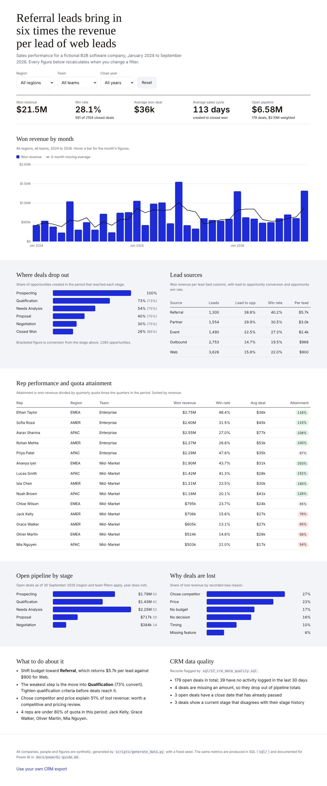

# CRM Sales Analytics: SQL + Dashboard on Salesforce-style Data

An end-to-end sales analytics project on a CRM dataset modelled on standard Salesforce objects
(User, Account, Lead, Opportunity, Opportunity History, Task). It answers the questions a sales
operations or revenue analyst gets every week: how are we tracking against quota, where does the
pipeline leak, which lead sources pay off, and can we trust the CRM data?

**Tableau version:** in progress (build steps in `docs/tableau-guide.md`)

**Web dashboard:** `https://coder-chauhan.github.io/crm-sales-analytics/`



## Key findings (Jan 2024 to Sep 2026)

| Metric | Value |
|---|---|
| Won revenue | $21.5M from 591 deals |
| Win rate | 28.1% of 2,104 closed deals |
| Average won deal / sales cycle | $36.4k / 113 days |
| Open pipeline (30 Sep 2026) | $6.58M across 179 deals, $2.10M weighted |

- **Referral leads return $5.7k of won revenue per lead, about 6x web ($900) and outbound ($966).** They convert to opportunities at 39% and win at 40%.
- **The biggest funnel leak is the first step:** only 73% of opportunities move past Prospecting, and only 26% of all opportunities reach Closed Won (some are still open).
- **Needs Analysis is the slowest stage** at about 31 days on average.
- **Competitors and price account for 51% of lost revenue**, a case for a competitive and pricing review.
- **Rep performance is uneven:** win rates range from 13% to 48%, and 4 mid-market reps are under 80% of quota for the period.
- **CRM hygiene:** 39 open deals have no activity in 30 days, 4 deals have no amount, 3 open deals have a close date in the past and 3 have a stage that disagrees with their history.

## What is in the repo

```
data/                 Synthetic CRM tables (CSV): users, accounts, leads, opportunities,
                      opportunity_history, activities
sql/00_schema.sql     Table definitions, keys and indexes (SQLite, portable to PostgreSQL)
sql/01-12_*.sql       Twelve analysis queries (see below)
outputs/              Each query's result as CSV
scripts/
  generate_data.py    Builds the dataset (fixed seed, reproducible)
  run_analysis.py     Loads the CSVs into SQLite and runs every query
  build_dashboard.py  Packs the data into the interactive web dashboard
  export_tableau.py   Writes flat, Tableau-ready extracts to tableau/data/
tableau/data/         Extracts for Tableau: opportunities, funnel, quota by quarter,
                      lead source summary, data quality
dashboard/template.html   Dashboard source (vanilla JS + SVG, no framework)
docs/index.html       Built dashboard
docs/tableau-guide.md Calculated fields, worksheets and layout to build it in Tableau Public
```

## SQL analyses

| # | Query | Business question | Techniques |
|---|---|---|---|
| 01 | KPI summary | How is the team performing overall? | CTEs, conditional aggregation, scalar subqueries |
| 02 | Monthly revenue trend | Is revenue growing? Is it seasonal? | `SUM() OVER` (YTD), moving average with `ROWS BETWEEN`, `LAG()` |
| 03 | Rep leaderboard | Who leads, who needs coaching? | JOINs, `RANK() OVER (PARTITION BY region)` |
| 04 | Quota attainment | Who hit quota each quarter? | `CROSS JOIN` to keep zero-win quarters, `LEFT JOIN`, `CASE` banding |
| 05 | Pipeline by stage | What is in the pipeline and what is it worth weighted? | probability weighting, deal ageing |
| 06 | Funnel conversion | Where do we lose deals? | `VALUES` CTE, furthest stage reached, `FIRST_VALUE()`, `LAG()` |
| 07 | Stage velocity | Where do deals stall? | `LEAD()` over stage history |
| 08 | Lead source performance | Which channels should marketing fund? | multi-CTE join, lead to opp to won conversion |
| 09 | Sales cycle by segment | How long do different deals take? | size banding, date arithmetic |
| 10 | Engagement vs win rate | Do more touches mean more wins? | `NTILE(4)`, rate normalised by deal length to remove bias |
| 11 | Loss reasons | Why do we lose? | `SUM() OVER ()` for share of total |
| 12 | CRM data quality | Can we trust the pipeline? | `UNION ALL` checks, correlated subqueries, `NOT EXISTS` |

## Run it

```bash
pip install -r requirements.txt
python scripts/generate_data.py     # optional: data/ is already included
python scripts/run_analysis.py      # builds crm.db, runs all queries, writes outputs/
python scripts/build_dashboard.py   # writes docs/index.html
python scripts/export_tableau.py    # writes tableau/data/*.csv
```

The dashboard's figures are computed in the browser from opportunity-level rows and match the SQL
output exactly (for example the KPI cards equal `outputs/01_kpi_summary.csv` with no filters set).

## About the data

All companies, people and numbers are synthetic, generated to behave like a B2B SaaS CRM:
14 reps in three regions and two teams with quarterly quotas, about 10,700 leads from five sources,
2,283 opportunities that move through a five-stage process with realistic drop-off and stage times,
28,000 logged activities, a Q4 buying season, company growth over time and a handful of
deliberately dirty records for the data-quality checks.

To use a real CRM export, put Salesforce reports for these objects into `data/` with the column names
in `sql/00_schema.sql` and rerun the two scripts.

## Tools

SQL (SQLite), Python (pandas, NumPy), Tableau (calculated fields, table calculations, parameters),
JavaScript/SVG for the web dashboard.
